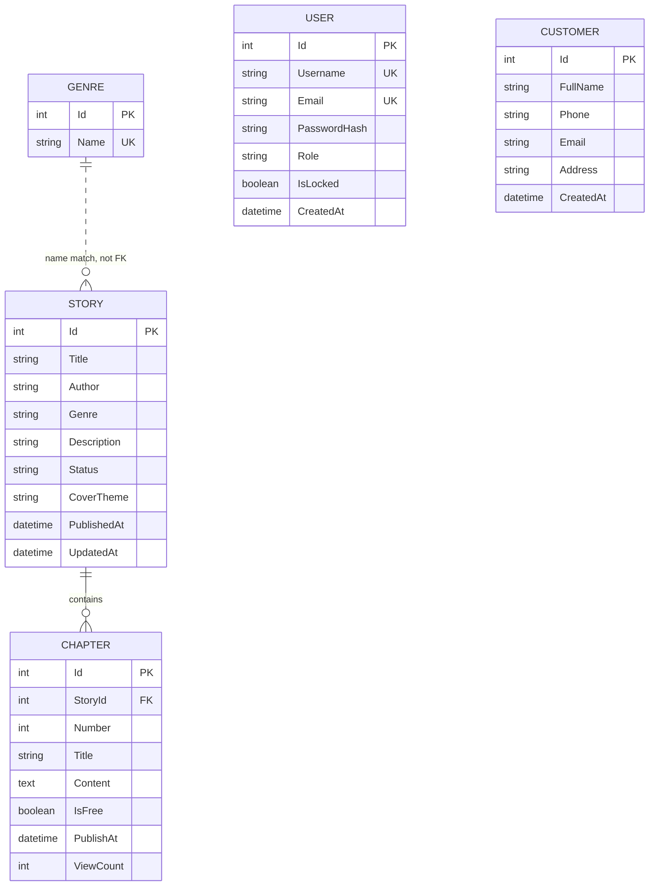

# SRS — Dữ liệu và giao diện

## 1. Giao diện người dùng

### Web

- Backend phục vụ ứng dụng tại /app/; các trang hiện có gồm khám phá, chi tiết truyện, đọc, tài khoản và khu vực quản trị.
- Client gọi API JSON cùng origin trong cấu hình phục vụ chính. Khi chạy riêng để phát triển, API client mặc định dùng http://localhost:5059.
- Phiên Web hiện được lưu trong sessionStorage; cài đặt trình đọc được lưu trong localStorage.
- Trang đọc hỗ trợ chương trước/sau, cỡ chữ và giao diện sáng/tối.

### Android

- Ứng dụng dùng Kotlin, Jetpack Compose, Navigation Compose và Retrofit.
- API client thêm JWT Bearer nếu SessionManager có token; phản hồi 401 sẽ xóa phiên.
- Base URL hiện được đặt cố định trong ApiService.kt. Hướng dẫn README emulator và giá trị trong mã nguồn chưa thống nhất; cần chốt trước khi nghiệm thu.
- Màn hình hiện có gồm khám phá, chi tiết, đọc, đăng nhập và đăng ký.

## 2. Giao diện Backend/API

API dùng HTTP(S), JSON và tiền tố /api. Các route quản trị yêu cầu header Authorization: Bearer <JWT> với role Admin.

| Method | Endpoint | Quyền | Mục đích |
|---|---|---|---|
| GET | /api/health | Công khai | Kiểm tra API đang phản hồi; không kiểm tra DB. |
| POST | /api/auth/register | Công khai | Đăng ký tài khoản. |
| POST | /api/auth/login | Công khai | Đăng nhập và nhận JWT. |
| GET | /api/auth/me | Đăng nhập | Lấy thông tin tài khoản hiện tại. |
| GET | /api/stories | Công khai | Tìm/lọc/sắp xếp/phân trang truyện. |
| GET | /api/stories/{id} | Công khai; Admin thấy thêm nội dung chưa phát hành | Xem chi tiết và mục lục truyện. |
| GET | /api/stories/{id}/chapters | Công khai | Lấy mục lục chương. Hiện phản hồi có cờ IsPublished nhưng cũng trả metadata chương chưa phát hành. |
| GET | /api/stories/{storyId}/chapters/{number} | Công khai cho chương đã phát hành | Lấy nội dung; tăng ViewCount; trả số chương trước/sau. Chưa kiểm tra IsFree/quyền trả phí. |
| POST, PUT, DELETE | /api/stories và /api/stories/{id} | Admin | CRUD truyện. |
| POST, PUT, DELETE | /api/stories/{id}/chapters và /api/stories/{id}/chapters/{chapterId} | Admin | CRUD chương. |
| GET | /api/chapters/{id} | Admin | Lấy đầy đủ dữ liệu biên tập chương. |
| GET | /api/genres | Công khai | Danh sách thể loại và số truyện. |
| POST, PUT, DELETE | /api/genres và /api/genres/{id} | Admin | CRUD thể loại. |
| GET, POST, PUT, DELETE | /api/customers và /api/customers/{id} | Admin | CRUD bản ghi Customer độc lập với tài khoản User. |

### Tham số truy vấn truyện

| Tham số | Ý nghĩa | Giới hạn/giá trị hiện tại |
|---|---|---|
| search hoặc keyword | Tìm trong tên truyện/tác giả | Tối đa 200 ký tự; keyword được ưu tiên nếu gửi cả hai. |
| genreId | Lọc theo thể loại | Một thể loại mỗi truy vấn. |
| status | Lọc trạng thái | Hỗ trợ Ongoing/Completed và tên trạng thái lưu trong DB. |
| sort | Thứ tự | updated mặc định; newest; views. |
| page | Trang | Tối thiểu 1; mặc định 1. |
| pageSize | Số kết quả | 1–100; mặc định 24. |

API hiện có thể trả danh sách thuần hoặc đối tượng phân trang tùy tham số gửi vào để tương thích các client hiện có. Hợp đồng đích nên chuẩn hóa một kiểu response phân trang.

### Mã kết quả HTTP chính

| Mã | Ý nghĩa thường gặp |
|---|---|
| 200 | Đọc dữ liệu hoặc đăng nhập thành công. |
| 201 | Tạo mới thành công. |
| 204 | Cập nhật/xóa thành công, không có nội dung trả về. |
| 400 | Dữ liệu không hợp lệ. |
| 401 | Thiếu hoặc token không hợp lệ; đăng nhập sai. |
| 403 | Không có quyền hoặc tài khoản bị khóa khi đăng nhập. |
| 404 | Không tìm thấy đối tượng/chương. |
| 409 | Xung đột nghiệp vụ như trùng tên, trùng số chương hoặc chương chưa có nội dung. |

Response lỗi hiện chưa được chuẩn hóa hoàn toàn giữa tất cả controller. Tài liệu API chi tiết có thể xem qua Swagger khi chạy ở môi trường Development.

## 3. Giao diện dữ liệu và mô hình hiện tại

Lưu ý: sơ đồ thể hiện mô hình hiện tại, không phải mô hình mục tiêu cuối cùng. Story.Genre đang là chuỗi tên thể loại, chưa phải khóa ngoại/bảng liên kết nhiều-nhiều. User và Customer là hai thực thể độc lập. Chưa có bảng Package, Subscription, Purchase, Transaction, ReadingProgress, Follow, Notification, Comment hoặc Report.

### Từ điển dữ liệu

| Thực thể | Trường/ràng buộc hiện tại | Ghi chú |
|---|---|---|
| User | Id; Username duy nhất; Email tối đa 256 ký tự và duy nhất nếu khác null; PasswordHash; Role mặc định User; IsLocked; CreatedAt UTC. | Username đăng ký 3–30 ký tự; email bắt buộc khi đăng ký; password 8–128 ký tự. |
| Story | Id; Title tối đa 200; Author 120; Genre 80; Description 3000; Status 30; CoverTheme 30; PublishedAt; UpdatedAt. | Chỉ một Genre dạng chuỗi; chưa lưu URL/tệp ảnh bìa hoặc giá. |
| Chapter | Id; StoryId; Number 1–100000; Title tối đa 200; Content tối đa 1.000.000 ký tự; IsFree; PublishAt; ViewCount. | Cặp StoryId + Number duy nhất; xóa Story sẽ cascade đến Chapter. |
| Genre | Id; Name tối đa 80, duy nhất. | Story tham chiếu bằng chuỗi tên hiện tại. |
| Customer | Id; FullName; Phone; Email; Address; CreatedAt. | Không liên kết với User; các DTO yêu cầu trường bắt buộc và email hợp lệ. |

### Ràng buộc và quy tắc dữ liệu mục tiêu

- Tên username/email không được trùng; xử lý xung đột song song bằng unique index.
- Số chương duy nhất trong mỗi truyện.
- Tên thể loại duy nhất; không xóa thể loại đang được dùng.
- Tên trạng thái truyện hiện giới hạn ở “Đang cập nhật” và “Hoàn thành”. CoverTheme hiện giới hạn ở teal, indigo, rose, amber, sage hoặc slate.
- Ngày giờ phát hành lưu/so sánh theo UTC.
- Để hỗ trợ nhiều thể loại, cần thay chuỗi Story.Genre bằng quan hệ chuẩn hóa hoặc bảng liên kết; phải có phương án chuyển dữ liệu migration.
- Để triển khai thanh toán/quyền đọc, cần chốt mô hình sản phẩm, tiền tệ, giao dịch, gói, thời hạn và idempotency trước khi mở API tương ứng.

## 4. Xác thực và phiên

- Đăng ký tạo role User; mật khẩu được băm bằng BCrypt.
- Đăng nhập phát JWT với issuer, audience, key ký HMAC-SHA256, thời điểm hết hạn, NameIdentifier, Name và Role.
- Thời lượng token lấy từ cấu hình; appsettings hiện đặt 60 phút.
- Backend yêu cầu JWT key tối thiểu 32 byte. Cấu hình secret được cung cấp ngoài repository.
- Client gửi token bằng Authorization: Bearer. Web giữ phiên trong sessionStorage; Android dùng SessionManager.
- API hiện không có refresh token; khi hết hạn người dùng cần đăng nhập lại.

## 5. Tích hợp bên ngoài

- SQL Server là hệ quản trị dữ liệu; EF Core migration quản lý phiên bản schema.
- Không thấy tích hợp nhà cung cấp thanh toán, email, push notification hoặc lưu trữ ảnh bên ngoài trong mã nguồn hiện tại.
- Product Backlog yêu cầu thanh toán giả lập. Mọi tích hợp ngoài mới cần định nghĩa sandbox, xác thực webhook, xử lý lặp, timeout và đối soát riêng.

## 6. Các điểm cần xử lý trước khi chốt hợp đồng

1. Ẩn metadata chương chưa phát hành khỏi mục lục công khai hay cho hiển thị lịch phát hành nhưng không lộ nội dung?
2. Mọi chương hiện được đọc công khai dù IsFree=false; cần thống nhất khi nào bật paywall và entitlement.
3. Chuẩn hóa response danh sách truyện (list thuần hay paged object) để Web và Android không cần nhánh tương thích.
4. Chốt quan hệ nhiều thể loại, ảnh bìa và chính sách xóa/đổi tên thể loại.
5. Chốt URL emulator/thiết bị thật và đưa base URL Android vào cấu hình môi trường.
6. Chốt chuẩn lỗi API, khả năng kiểm tra database trong health check, cũng như yêu cầu hiệu năng/backup.
