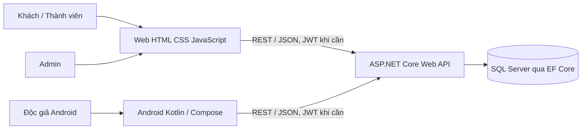

# Đặc tả yêu cầu phần mềm (SRS)

## Kiểm soát tài liệu

| Thuộc tính | Giá trị |
|---|---|
| Sản phẩm | Hệ thống quản lý đọc truyện |
| Phiên bản tài liệu | 1.0 |
| Ngày lập | 20/10/2026 |
| Trạng thái | Bản dự thảo, cần nhóm xác nhận các mục TBD |
| Cơ sở | Product backlog, README và mã nguồn trong repository |

> Tài liệu được tổ chức theo các chủ đề thường dùng trong SRS và hướng dẫn IEEE 29148; đây không phải tuyên bố chứng nhận tuân thủ tiêu chuẩn. Các trạng thái triển khai phản ánh việc đọc repository, không xác nhận ứng dụng đã chạy hoặc đã qua kiểm thử.

## 1. Mục đích

Đặc tả các yêu cầu chức năng và phi chức năng cho hệ thống đọc truyện chạy trên Web và Android, dùng chung Backend REST API và cơ sở dữ liệu. Tài liệu là cơ sở để thống nhất phạm vi, thiết kế, triển khai và nghiệm thu; đồng thời chỉ rõ phần nào đã có và phần nào còn là mục tiêu trong backlog.

## 2. Phạm vi sản phẩm

### 2.1 Mục tiêu

Hệ thống giúp độc giả tìm và đọc truyện; cung cấp công cụ cho quản trị viên quản lý truyện, chương, thể loại và dữ liệu liên quan. Web và Android gọi chung Backend để dùng cùng nguồn dữ liệu.

### 2.2 Phạm vi theo mục tiêu dự án

Backlog đặt mục tiêu rộng hơn phiên bản hiện có, gồm tài khoản và phân quyền; quản lý nội dung; tìm kiếm và đọc; gói đọc, mua truyện và giao dịch giả lập; kiểm tra quyền đọc; tiến độ đọc; theo dõi và thông báo; thảo luận và kiểm duyệt; quản lý thành viên; thống kê; đọc offline trên Android.

### 2.3 Phạm vi đã quan sát trong repository

- Backend ASP.NET Core Web API, EF Core và SQL Server.
- Web HTML/CSS/JavaScript có trang khám phá, chi tiết, đọc truyện, tài khoản và trang quản trị.
- Android Kotlin/Jetpack Compose dùng Retrofit để gọi API.
- Đăng ký, đăng nhập, JWT, endpoint lấy tài khoản hiện tại và kiểm soát quyền Admin.
- CRUD truyện/chương/thể loại; tìm kiếm, lọc, sắp xếp và phân trang truyện; đọc chương đã phát hành; ghi nhận số lượt đọc.
- API CRUD khách hàng thuộc mô hình Customer riêng.

Thanh toán, gói đọc, quyền mua, tiến độ đọc đồng bộ, theo dõi, thông báo, thảo luận, thống kê quản trị và đọc offline chưa được xem là chức năng đã hoàn thành. Chi tiết và trạng thái của từng yêu cầu nằm trong [Yêu cầu chức năng](SRS-Functional-Requirements.md) và [Ma trận truy vết](SRS-Traceability.md).

## 3. Thuật ngữ

| Thuật ngữ | Ý nghĩa |
|---|---|
| Độc giả/Khách | Người chưa đăng nhập; được dùng các chức năng công khai. |
| Thành viên | Tài khoản người đọc đã đăng ký; mã nguồn hiện đặt role là User. |
| Quản trị viên | Tài khoản role Admin, được phép dùng API quản trị. |
| Truyện | Tác phẩm có thông tin giới thiệu và một hoặc nhiều chương. |
| Chương | Đơn vị nội dung có số thứ tự, tên, nội dung và thời điểm phát hành. |
| Quyền đọc | Quyền truy cập nội dung; backlog dự kiến dựa trên nội dung miễn phí, gói còn hạn hoặc truyện đã mua. Luồng trả phí chưa triển khai. |
| SRS | Software Requirements Specification — đặc tả yêu cầu phần mềm. |
| TBD | Nội dung cần chủ sản phẩm/nhóm xác nhận. |

## 4. Người dùng và đặc điểm

| Nhóm | Mục tiêu | Quyền dự kiến |
|---|---|---|
| Khách | Tìm truyện, xem chi tiết và đọc nội dung miễn phí đã phát hành. | API công khai; không có quyền quản trị. |
| Thành viên | Dùng các chức năng tài khoản và, theo mục tiêu backlog, mua/đăng ký dịch vụ, lưu tiến độ, theo dõi, thảo luận. | API công khai và API dành cho người đăng nhập khi được triển khai. |
| Admin | Quản lý nội dung và vận hành hệ thống. | API có JWT role Admin. |

Trong phiên bản hiện tại, luồng tài khoản cung cấp đăng ký/đăng nhập và đọc thông tin tài khoản. Các quyền thành viên nâng cao trong backlog chưa có. API CRUD Customer không tương đương quản lý tài khoản User.

## 5. Bối cảnh và kiến trúc

Backend chịu trách nhiệm xác thực, phân quyền, kiểm tra dữ liệu và xử lý nghiệp vụ. Web được Backend phục vụ dưới đường dẫn /app/. Ứng dụng Android là client riêng và phải cấu hình địa chỉ API phù hợp môi trường chạy.

## 6. Môi trường vận hành và ràng buộc

- Backend hiện nhắm .NET 8, ASP.NET Core Web API, EF Core và SQL Server. Cấu hình kết nối database và khóa JWT phải được đặt ngoài mã nguồn bằng User Secrets hoặc biến môi trường.
- Web dùng React/Vite; có thể chạy bằng Vite khi phát triển hoặc build rồi để Backend phục vụ dưới `/app/`.
- Android hiện dùng Kotlin, Jetpack Compose, Retrofit và Android SDK theo cấu hình dự án.
- API trao đổi JSON qua HTTP(S). Endpoint quản trị dùng JWT Bearer và role Admin.
- Migration EF Core là cơ chế cập nhật schema database.
- Product Backlog ghi .NET 10, React/TypeScript/Vite/Tailwind và Room cho Android; repository hiện dùng .NET 8, React/Vite và Android Retrofit. Cần xác nhận các khác biệt này trước nghiệm thu.
- README Mobile hướng dẫn địa chỉ emulator 10.0.2.2, trong khi ApiService.kt hiện đặt BASE_URL là 127.0.0.1. Cần thống nhất cấu hình chạy Android trước khi nghiệm thu trên emulator.

## 7. Giả định và phụ thuộc

- SQL Server hoạt động và schema đã được cập nhật bằng migration trước khi chạy API.
- Môi trường chạy cung cấp ConnectionStrings:DefaultConnection và Jwt:Key; khóa JWT dài tối thiểu 32 byte.
- Môi trường trình duyệt hoặc thiết bị Android kết nối được tới Backend.
- Nội dung truyện, thông tin truyện và lịch phát hành do Admin nhập; quyền sử dụng nội dung và ảnh bìa do đơn vị vận hành bảo đảm.
- Backlog yêu cầu cổng thanh toán giả lập; chưa xác định có cần tích hợp cổng thanh toán thật.

## 8. Tổng quan chức năng

| Nhóm chức năng | Mô tả | Trạng thái triển khai |
|---|---|---|
| Tài khoản và phân quyền | Đăng ký, đăng nhập, JWT, role Admin. | Đã có ở mức cơ bản. |
| Khám phá truyện | Tìm, lọc, sắp xếp, phân trang. | Đã có; cần đối chiếu yêu cầu nhiều danh sách/trải nghiệm đầy đủ. |
| Đọc truyện | Chi tiết truyện, mục lục, nội dung chương, điều hướng và cài đặt đọc. | Đã có phần cốt lõi; quyền trả phí chưa có. |
| Quản trị nội dung | CRUD truyện, chương, thể loại; lịch phát hành. | Đã có; tải ảnh bìa và nhiều thể loại chưa có. |
| Thanh toán và gói đọc | Đăng ký/gia hạn/mua, giao dịch và quyền đọc. | Chưa triển khai. |
| Cộng đồng và cá nhân hóa | Tiến độ, theo dõi, thông báo, thảo luận. | Chưa triển khai. |
| Quản trị thành viên và báo cáo | Quản lý User và thống kê. | Chưa triển khai đầy đủ; Customer là thực thể riêng. |
| Mobile offline | Tải và đọc chương khi không có mạng. | Chưa triển khai. |

## 9. Yêu cầu phi chức năng

Các yêu cầu dưới đây là mục tiêu chất lượng. Khi chưa ghi “đã xác minh”, chúng chưa được đo bằng kiểm thử.

### 9.1 Bảo mật

- NFR-SEC-01: Mật khẩu không được lưu dạng rõ; mã nguồn hiện dùng BCrypt.
- NFR-SEC-02: API phải kiểm tra chữ ký, issuer, audience và thời hạn JWT; API quản trị phải yêu cầu role Admin.
- NFR-SEC-03: Bí mật triển khai, gồm connection string, JWT key và mật khẩu seed, không được commit vào repository.
- NFR-SEC-04: Bản triển khai ngoài máy phát triển phải dùng HTTPS. Cấu hình HTTP hiện có chỉ dành cho phát triển cục bộ.
- NFR-SEC-05: Kiểm tra quyền đọc trả phí phải thực hiện tại Backend, không dựa riêng vào ẩn/hiện giao diện. Yêu cầu này chưa đạt cho tới khi có mô hình thanh toán/quyền đọc.
- NFR-SEC-06: Khi nghiệm thu, xác minh API quản trị trả 401 nếu thiếu token và 403 nếu token không có role Admin.

### 9.2 Tính đúng đắn và toàn vẹn dữ liệu

- NFR-DATA-01: Mỗi username và email đăng ký chỉ thuộc về một tài khoản.
- NFR-DATA-02: Số chương không trùng trong cùng một truyện; xóa truyện xóa các chương liên quan theo quan hệ cascade hiện tại.
- NFR-DATA-03: Dữ liệu nhận từ client phải qua kiểm tra bắt buộc, giới hạn độ dài và quy tắc miền trước khi lưu.
- NFR-DATA-04: Giao dịch thanh toán (khi xây dựng) phải có tính lũy đẳng hoặc cơ chế chống cấp quyền lặp; chi tiết TBD.

### 9.3 Hiệu năng và dung lượng

- NFR-PERF-01: API danh sách phải hỗ trợ phân trang; pageSize tối đa hiện là 100.
- NFR-PERF-02: Từ khóa tìm truyện tối đa hiện là 200 ký tự.
- NFR-PERF-03: Ngưỡng thời gian phản hồi, số người dùng đồng thời và kích thước nội dung tối đa khi vận hành thực tế chưa được backlog xác định; chủ sản phẩm cần chốt trước phát hành.

### 9.4 Khả dụng, phục hồi và vận hành

- NFR-OPS-01: Cần quy định lịch sao lưu SQL Server, thời gian lưu và quy trình khôi phục trước khi dùng dữ liệu thật (TBD).
- NFR-OPS-02: GET /api/health hiện chỉ xác nhận API trả lời; chưa kiểm tra khả năng truy cập database.
- NFR-OPS-03: Cần thống nhất định dạng lỗi và ghi log để hỗ trợ vận hành; hiện response lỗi chưa được chuẩn hóa hoàn toàn.
- NFR-OPS-04: Mục tiêu uptime, RTO và RPO chưa xác định (TBD).

### 9.5 Dễ sử dụng và tương thích

- NFR-UX-01: Các luồng đọc phải hiển thị trạng thái đang tải, lỗi và không có dữ liệu, đồng thời cho phép thử lại khi phù hợp.
- NFR-UX-02: Trang đọc cần điều hướng chương trước/sau, điều chỉnh cỡ chữ và chế độ sáng/tối trên các nền tảng được nghiệm thu.
- NFR-UX-03: Web cần hỗ trợ thao tác bàn phím, hiển thị focus rõ và bố cục thích ứng. Mức WCAG/browser cụ thể cần nhóm xác nhận.
- NFR-UX-04: Nội dung giao diện hiện ưu tiên tiếng Việt và phải hiển thị đúng Unicode.

## 10. Tiêu chí nghiệm thu cấp hệ thống

1. Người dùng có thể đăng ký, đăng nhập và nhận kết quả xác thực theo hợp đồng API; tài khoản bị khóa không đăng nhập được.
2. Khách có thể tìm truyện, xem thông tin và đọc chương đã phát hành có nội dung.
3. Admin có thể quản lý truyện, chương và thể loại sau khi xác thực; thao tác sai dữ liệu trả lỗi phù hợp.
4. Web và Android đọc cùng dữ liệu từ Backend.
5. Các mục tiêu thanh toán, quyền đọc trả phí, tiến độ, theo dõi, thảo luận, báo cáo và offline chỉ được nghiệm thu khi các yêu cầu tương ứng trong backlog đã triển khai và có kiểm thử chấp nhận.
6. Cấu hình database/JWT được cung cấp an toàn theo tài liệu chạy dự án.

## 11. Tài liệu liên quan và mục còn mở

- [Yêu cầu chức năng và luồng sử dụng](SRS-Functional-Requirements.md)
- [Mô hình dữ liệu và hợp đồng API](SRS-Data-and-Interfaces.md)
- [Ma trận truy vết Product Backlog](SRS-Traceability.md)
- [Hướng dẫn chạy Backend](../Backend/README.md), [Web React](../Frontend/README.md), [Android](../Mobile/README.md)

Các quyết định cần nhóm xác nhận: có cần nâng backend từ .NET 8 lên .NET 10 để khớp Project Information hay không; cấu hình URL Android; mức độ ưu tiên từng PB; thanh toán giả lập hay thật; chính sách quyền đọc; nhiều thể loại và ảnh bìa; yêu cầu hiệu năng, sao lưu, bảo mật và khả năng truy cập. Giao diện web hiện được triển khai bằng React/Vite.
